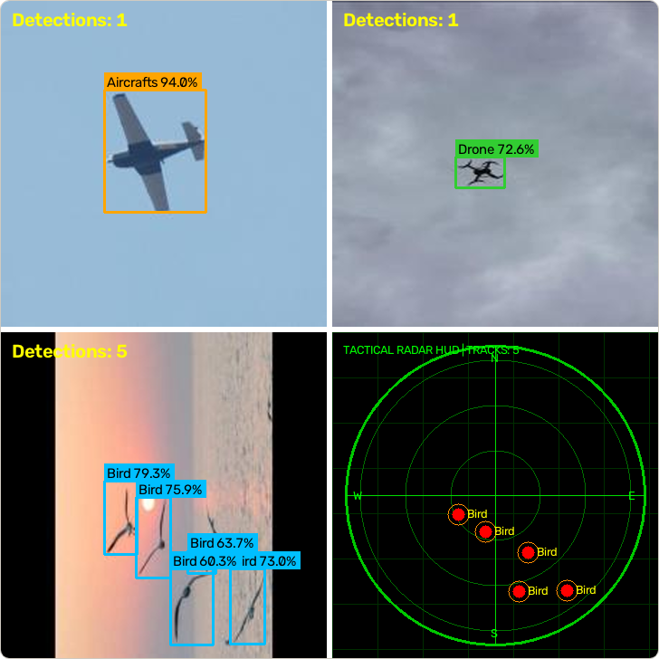
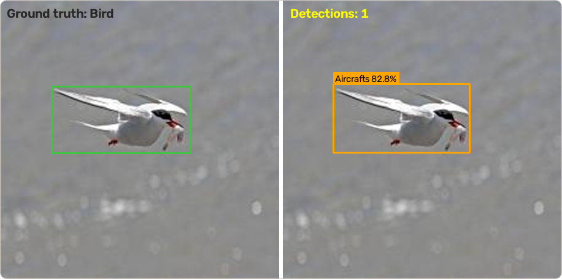

# Aerial Object Detection with YOLO11

A YOLO11 detector that tells **aircraft, birds and drones** apart in sky images, with the code to train, evaluate and run it, and a step-by-step guide that uses this real project to show how to train YOLO on your own dataset.

<p align="center">
  
  <br>
  <sub>Predictions of this project's model on validation images (confidence 0.6, upscaled for display). The bottom-right panel is the radar view of the bottom-left image.</sub>
</p>

## Results

The shipped model (`yolo11s`, fine-tuned) on the 1,778-image validation split, 640 px:

| Evaluation | Precision | Recall | mAP@50 | mAP@50-95 | Status |
| :-- | :-: | :-: | :-: | :-: | :-- |
| Fresh run of `scripts/val.py` on 2026-11-10 (CPU, Ultralytics 8.4.208) | 0.887 | 0.850 | **0.899** | **0.557** | Verified |
| Training log, last epoch (57) | 0.888 | 0.844 | 0.900 | 0.565 | From the recorded log in [results/logs](results/logs) |

| Class | Images | Instances | Precision | Recall | mAP@50 | mAP@50-95 |
| :-- | :-: | :-: | :-: | :-: | :-: | :-: |
| Aircrafts | 754 | 977 | 0.887 | 0.868 | 0.902 | 0.588 |
| Bird | 262 | 1,159 | 0.867 | 0.789 | 0.864 | 0.428 |
| Drone | 767 | 958 | 0.906 | 0.895 | 0.931 | 0.654 |

Read these with three caveats:

- **Some validation images are near-copies of training images.** The dataset contains augmented copies of the same source photo and the original split was random per file. `python -m yolotools leakage` finds **173 of the 1,778 validation images (9.7%)** that share a source photo with a training image, so the scores are probably optimistic. The model has not been re-trained on a split by source photo.
- The validation split also chose the checkpoint; there is no separate test set.
- Each setting was trained once; there is no spread across seeds.

**Bird is the weakest class** and the model makes real mistakes. This tern (a bird) is labelled `Aircrafts` with 83% confidence:

<p align="center">
  
  <br>
  <sub>Ground truth (left) and prediction (right) on a validation image.</sub>
</p>

## What is in this repository

| Part | What it is |
| :-- | :-- |
| [`docs/`](docs/00-start-here.md) | An eleven-chapter guide, from planning a dataset to using the trained model, using this project for every example |
| `src/`, `scripts/` | The detector wrapper, the radar view, and command-line tools for training, validation and detection (images, folders, video, webcam) |
| `yolotools/` | Dataset tools: label checker, `data.yaml` writer, group-aware split, leakage count, split rebuilder |
| `sample-data/` | 50 real images with labels (33 train, 17 validation, no overlap) for trying every step in minutes |
| `splits/` | The exact training and validation file lists the results are measured on |
| `results/` | Training logs, run arguments, unedited plots and the console output of the fresh validation run |
| `weights/` | Where the trained model goes; see [weights/README.md](weights/README.md) |

## The guide

| # | Chapter | You will learn |
| :-: | :-- | :-- |
| 0 | [Start here: a smoke test](docs/00-start-here.md) | Check that your machine runs the whole pipeline, with the included sample data |
| 1 | [Plan your project](docs/01-plan-your-project.md) | Classes, success metric, how much data, hardware |
| 2 | [Collect and label images](docs/02-collect-and-label.md) | Labelling rules, the YOLO label format with a worked example |
| 3 | [Dataset layout and data.yaml](docs/03-dataset-layout-and-yaml.md) | Folder rules, the path trap, the label checker |
| 4 | [Split without leaking](docs/04-split-without-leaking.md) | Why random splits can inflate scores, and how to avoid it |
| 5 | [Set up your environment](docs/05-set-up-environment.md) | Python, PyTorch (CPU or GPU), Ultralytics, licence note |
| 6 | [Train a model](docs/06-train.md) | The command, the settings that matter, outputs, timing |
| 7 | [Evaluate the model](docs/07-evaluate.md) | Precision, recall, mAP, reading the plots |
| 8 | [Improve the model](docs/08-improve.md) | An error-driven loop; data before settings |
| 9 | [Use the trained model](docs/09-use-the-model.md) | Predict, thresholds, Python API, ONNX export |
| 10 | [Troubleshooting](docs/10-troubleshooting.md) | Symptoms, causes, fixes |
| 11 | [The aerial detector](docs/11-the-aerial-detector.md) | This project end to end, with its flaws, and how to reproduce it |
| 12 | [The radar view and the hardware trigger](docs/12-radar-view-and-hardware.md) | The radar overlay and the optional Arduino trigger |

## Run it

Requires Python and an installed PyTorch (see [chapter 5](docs/05-set-up-environment.md)). Tested on Windows 11, Python 3.14.6, CPU-only PyTorch 2.15, Ultralytics 8.4.208. Run commands from the repository root.

```bash
git clone <this-repo-url>
cd <this-repo>
python -m venv .venv                       # activate it, then install PyTorch first (chapter 5)
pip install -r requirements.txt
python -m unittest discover -s tests       # 21 tests
python -m yolotools check --data sample-data/data.yaml
```

Train and test on the included sample (a smoke test, not a useful model), following [chapter 0](docs/00-start-here.md):

```bash
yolo detect train data=sample-data/data.yaml model=yolo11n.pt epochs=20 imgsz=320 device=cpu
```

With the trained weights in `weights/best.pt`:

```bash
python scripts/detect.py --model weights/best.pt --source sample-data/val/images --save --no-show
python scripts/radar_detect.py --model weights/best.pt --source 0        # webcam, plus the radar view; q to quit
python scripts/val.py --model weights/best.pt --data configs/data.yaml   # needs the full dataset in data/
```

The full dataset (8,888 images) is not stored here. [Chapter 11](docs/11-the-aerial-detector.md) explains how to download it and rebuild the exact split from `splits/`.

### What has been run

| Part | Status |
| :-- | :-- |
| Unit tests; label checker; leakage tool; split rebuild; `val.py` on the full validation set; `detect.py`; ONNX export | Verified 2026-11-10 (Windows, CPU) |
| Training of the shipped model | Recorded in `results/logs`; not re-run |
| Radar view | Classes rendered headless on validation images (the figure above); the live `radar_detect.py` window and webcam input were not opened |
| Arduino serial trigger (`scripts/hardware_trigger.py`) | Implemented, not verified (no hardware) |
| Linux, macOS, GPU training, cloud notebooks | Not tested |

## Limits and unfinished work

- Every dataset image is 227 x 227 px. Training at 640 px upsamples them, and small distant targets are hard.
- Helicopters, airliners and light aircraft share one class because the source labels do.
- The radar view is a 2D map of image position; it has no range or elevation.
- Not done: a re-split by source photo and re-training, a separate test set, tracking, finer aircraft classes.
- The model was trained on web-collected photos and flight-simulator images and may behave differently on real camera footage.

## Licence and credits

- Code: [MIT](LICENSE).
- Training uses [Ultralytics](https://github.com/ultralytics/ultralytics), licensed AGPL-3.0 (or commercially); the trained weights are derived from it. Check the terms before building a product on it.
- Dataset: Roboflow Universe `subhranil-dey-wttsv/drone-detection-axkso`, version 3, [CC BY 4.0](https://creativecommons.org/licenses/by/4.0/). The images in it come from third parties and their individual rights could not be verified; `sample-data/README.md` explains which images were left out.
