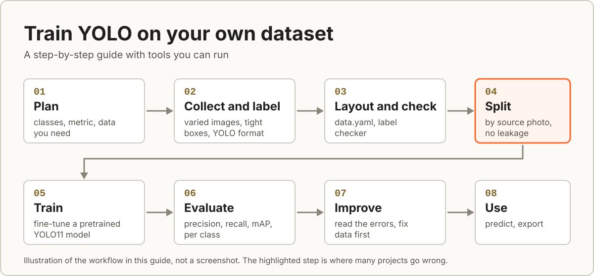

# 0. Start here: a smoke test

<p align="center">
  
  <br>
  <sub>The steps of this guide. An illustration, not a screenshot.</sub>
</p>

Before you spend days labelling, check that your computer can run the whole pipeline. This chapter does that with the 50 real images in [`sample-data/`](../sample-data/README.md): 33 for training and 17 for validation, from the aerial dataset used throughout this guide (aircraft, birds and drones).

The model you get from 33 images is **not useful**. The point is to see every step run and to know roughly what the output looks like.

## What you need

A working environment from [chapter 5](05-set-up-environment.md) (Python, PyTorch, `pip install -r requirements.txt`). Run every command from the repository root.

## 1. Check the data

```bash
python -m yolotools check --data sample-data/data.yaml
```

Expect `Result: no problems found`, with these counts:

| Split | Images | Aircrafts | Bird | Drone |
| :-- | :-: | :-: | :-: | :-: |
| train | 33 | 21 | 9 | 16 |
| val | 17 | 7 | 9 | 15 |

## 2. Train

```bash
yolo detect train data=sample-data/data.yaml model=yolo11n.pt epochs=20 imgsz=320 batch=16 device=cpu
```

`yolo11n.pt` (the smallest model, 2.6 million parameters) is downloaded on first use. In the run recorded for this guide, 20 epochs took 0.050 hours (about 3 minutes) on an Intel Core i5-13420H laptop CPU. Use `device=0` if you have an NVIDIA GPU and a CUDA build of PyTorch.

## 3. Validate

```bash
yolo detect val model=runs/detect/train/weights/best.pt data=sample-data/data.yaml imgsz=320
```

The recorded run printed:

```text
Class       Images  Instances   Box(P      R      mAP50  mAP50-95)
all             17         31   0.539   0.334   0.320   0.201
Aircrafts        7          7   0.118   0.714   0.490   0.318
Bird             2          9   0.664   0.221   0.340   0.225
Drone            8         15   0.836  0.0667   0.131  0.0591
```

These numbers are low and uneven, as they should be: 33 training images are far too few, and 31 validation boxes are too few to trust. Your numbers will differ a little. If everything is exactly 0, something is wrong; see [troubleshooting](10-troubleshooting.md).

## 4. Predict

```bash
yolo detect predict model=runs/detect/train/weights/best.pt source=sample-data/val/images imgsz=320 save=True
```

Open the images in `runs/detect/predict`. You should see boxes with class names and confidence scores, though with this tiny model many objects will be missed or mislabelled.

## 5. See what a trained model looks like (optional)

If you have the project's trained weights in `weights/best.pt` (see [weights/README.md](../weights/README.md)):

```bash
python scripts/detect.py --model weights/best.pt --source sample-data/val/images --save --no-show
```

Those weights come from 7,110 training images and give results like the ones in the [README](../README.md).

## If something failed

See [troubleshooting](10-troubleshooting.md). The most common problems are a wrong PyTorch build, running from the wrong folder, and a relative `path:` in `data.yaml`.

## What this proved

Your Python environment, the Ultralytics install, the dataset layout, `data.yaml`, training, validation and prediction all work. Now bring your own dataset, starting at [chapter 1](01-plan-your-project.md).
