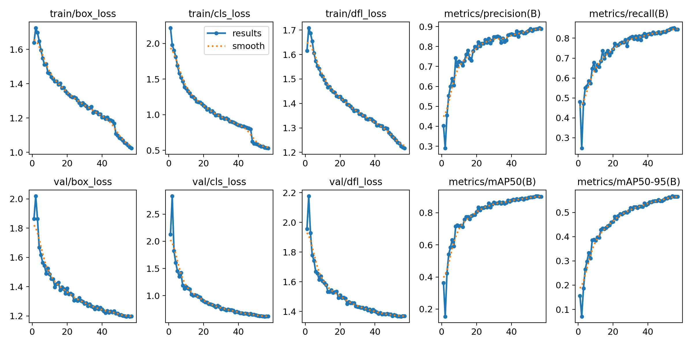
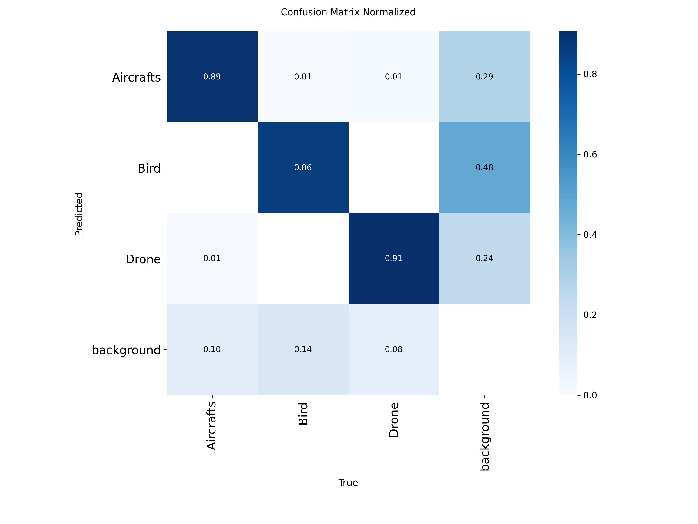

# 7. Evaluate the model

Training prints a lot of numbers. This chapter explains the ones that matter and how to read the plots, using results from the [aerial detector project](11-the-aerial-detector.md) as the example.

## The vocabulary

**IoU (intersection over union)** measures how well a predicted box overlaps a real box: the area they share divided by the area they cover together. 1.0 is a perfect match, 0 is no overlap.

A prediction counts as correct (a **true positive**) when its class is right and its IoU with a real box is at least a chosen threshold. Otherwise it is a **false positive**. A real object nobody found is a **false negative**.

- **Precision** = true positives / all predictions. *Of the boxes the model drew, how many were right?* Low precision means many false alarms.
- **Recall** = true positives / all real objects. *Of the real objects, how many did the model find?* Low recall means misses.
- **Confidence threshold.** Every prediction has a score. Raising the threshold removes weak predictions: precision goes up, recall goes down. Lowering it does the opposite. There is no free lunch; you pick the balance that fits the cost of each mistake (chapter 1).
- **AP** (average precision) summarises precision against recall for one class across all thresholds. **mAP** is the mean over the classes.
- **mAP@50** uses IoU 0.5 as the "correct" threshold: lenient about box position.
- **mAP@50-95** averages mAP over IoU thresholds 0.50, 0.55, ... 0.95: strict. It is always lower than mAP@50. Use it to compare models; use mAP@50 to see whether objects are found at all.

## Run the evaluation yourself

```bash
yolo detect val model=runs/detect/train/weights/best.pt data=data.yaml imgsz=640
```

Ultralytics prints one row for all classes and one per class:

```text
Class       Images  Instances   Box(P      R      mAP50  mAP50-95)
all           1778       3094   0.887   0.850   0.899   0.557
Aircrafts      754        977   0.887   0.868   0.902   0.588
Bird           262       1159   0.867   0.789   0.864   0.428
Drone          767        958   0.906   0.895   0.931   0.654
```

(These are the real results of this project's model on its validation set.)

**Always look at the per-class rows.** The overall number hid the fact that Bird, at 0.428, is far weaker than Drone at 0.654.

## Read the plots

Training writes plots into `runs/detect/<name>/`.

### results.png



- Training and validation **losses** should fall and flatten. If the training loss keeps falling but the validation loss starts to rise, the model is memorising the training set (overfitting): stop earlier, add data or add augmentation.
- The precision, recall and mAP curves should rise and flatten. If they are still climbing at the last epoch, train longer.
- Noisy curves with a small validation set are normal.

### confusion_matrix_normalized.png



In Ultralytics' plot, **columns are the true class and rows are the predicted class**, each column normalised to add up to about 1.

- The diagonal is the share of each true class predicted correctly (here 0.89, 0.86, 0.91).
- Off-diagonal cells between two classes show which classes get confused. Here Bird and Drone are almost never swapped.
- The **background column** shows how the model's *false alarms* are split by predicted class: of detections that match no labelled object, 0.48 were Birds, 0.29 Aircrafts, 0.24 Drones. The **background row** shows missed objects: 0.10, 0.14 and 0.08 of the real Aircrafts, Birds and Drones were not detected.

### The PR and F1 curves

(Newer Ultralytics versions name these files with a `Box` prefix, for example `BoxPR_curve.png`; older ones have `PR_curve.png`.) The precision-recall curve per class: the closer to the top-right corner, the better. The F1 curve shows the confidence threshold at which precision and recall balance best, a sensible starting value for the threshold you use in practice.

### val_batch*_pred.jpg

Open these. They show real validation images with the model's predictions. Looking at 20 of them tells you more than a table: you will see what kind of object it misses and what it confuses.

## Best checkpoint versus last epoch

Training saves `best.pt` (the epoch with the best validation fitness, a weighted mix of mAP@50 and mAP@50-95) and `last.pt` (the final epoch). In this project the best mAP@50-95 in the log was at epoch 54 (0.5674) and the last epoch scored 0.5648. Use `best.pt` for deployment, but remember that picking it **used the validation set**, so its score is a little optimistic. A separate test set fixes that (chapter 4).

## Re-run your evaluation and write down the details

An earlier version of this project's README quoted last-epoch numbers from the training log (mAP@50-95 0.565). Running `val` again on the shipped weights, on another machine and a newer Ultralytics version, gave 0.557. The cause was not investigated. The lesson: re-run the evaluation with the exact checkpoint you ship and record the versions and hardware next to the numbers.

## Sanity checks that catch most mistakes

- **Everything near 0 mAP** from the first epochs: label problems. Check class ids against `names`, check that label files are found (chapter 3), and open a few `train_batch*.jpg` images that training saves to see whether the boxes sit on the objects.
- **Suspiciously perfect scores**: leakage or a validation set that is too easy (chapter 4).
- **Good validation numbers but bad results on your own camera**: your data does not match the real use (chapter 1).
- **Metrics hold up overall but one class is poor**: look at that class's examples, box sizes and label consistency (chapter 8).

Next: [8. Improve the model](08-improve.md)
