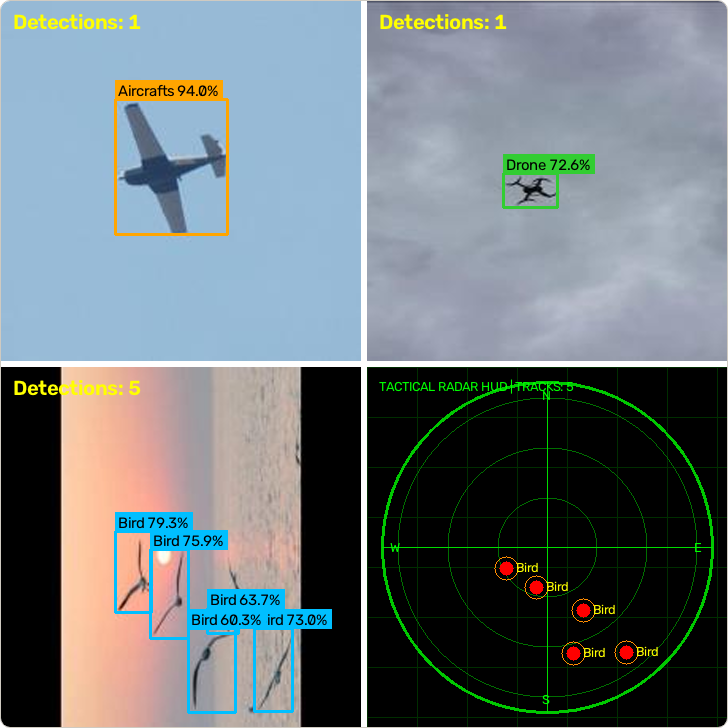

# 9. Use the trained model

## Run it on images, video and a camera

```bash
# One image, a folder of images, or a video file
yolo detect predict model=runs/detect/train/weights/best.pt source=path/to/image.jpg save=True
yolo detect predict model=runs/detect/train/weights/best.pt source=path/to/folder save=True
yolo detect predict model=runs/detect/train/weights/best.pt source=path/to/video.mp4 save=True

# A webcam (device 0) with a live window
yolo detect predict model=runs/detect/train/weights/best.pt source=0 show=True
```

`save=True` writes annotated copies to `runs/detect/predict`. These are real predictions of this project's model on validation images (confidence 0.6, upscaled for display); the last panel is the radar view of the bird image, produced by `scripts/radar_detect.py`'s classes:



## The two thresholds

```bash
yolo detect predict model=best.pt source=image.jpg conf=0.25 iou=0.7
```

- `conf` is the minimum confidence for a box to be kept. This is the precision/recall trade-off from chapter 7: raise it for fewer false alarms and more misses, lower it for the opposite. The F1 curve from evaluation shows where the two balance. Set it by testing on images from your real use.
- `iou` is used when several boxes cover the same object: boxes that overlap more than this are merged, keeping the most confident one. Raise it if close-together objects get merged; lower it if one object gets several boxes.

## Use it from Python

```python
from ultralytics import YOLO

model = YOLO("runs/detect/train/weights/best.pt")
results = model.predict("image.jpg", conf=0.25)

for box in results[0].boxes:
    x1, y1, x2, y2 = box.xyxy[0].tolist()      # pixel corners
    confidence = float(box.conf[0])
    name = model.names[int(box.cls[0])]
    print(name, round(confidence, 2), (round(x1), round(y1), round(x2), round(y2)))
```

`model.names` maps class numbers to the names from your `data.yaml`.

## Export for other runtimes

```bash
yolo export model=runs/detect/train/weights/best.pt format=onnx imgsz=640
```

On this project's `yolo11s` model it worked: it wrote a 36.2 MB `best.onnx` in about 30 seconds. In a clean environment Ultralytics installed the missing `onnx`, `onnxruntime` and `onnxslim` packages automatically the first time, so expect it to modify your environment. **Running the ONNX file for inference was not tested in this guide.** Ultralytics supports other export formats (for example TensorRT for NVIDIA devices); they are not covered here, so follow its documentation and test them yourself.

## Speed you can expect

Ultralytics reports speed during validation and prediction. The figures below were all measured on the same laptop CPU (13th Gen Intel Core i5-13420H) and are not deployment benchmarks. They vary a lot with how busy the machine is:

| Model | Image size | Inference per image |
| :-- | :-: | :-: |
| `yolo11n` (sample-data run) | 320 | 43 to 59 ms |
| `yolo11s` (this project's model) | 640 | 258 to 774 ms across three runs |

A GPU is usually much faster (not measured here). If you need real-time video on a small device, measure on that device.

## Before you rely on it

- Test on **new images from the real setting**, not only the validation set.
- Look at the failures, not only the average.
- Decide what a wrong answer costs and set `conf` for that (chapter 1).
- Keep the `data.yaml` (class names), the weights, the training `args.yaml` and the software versions together with the model.
- Re-check the licence terms of the tools you used (chapter 5).

Next: [10. Troubleshooting](10-troubleshooting.md)
