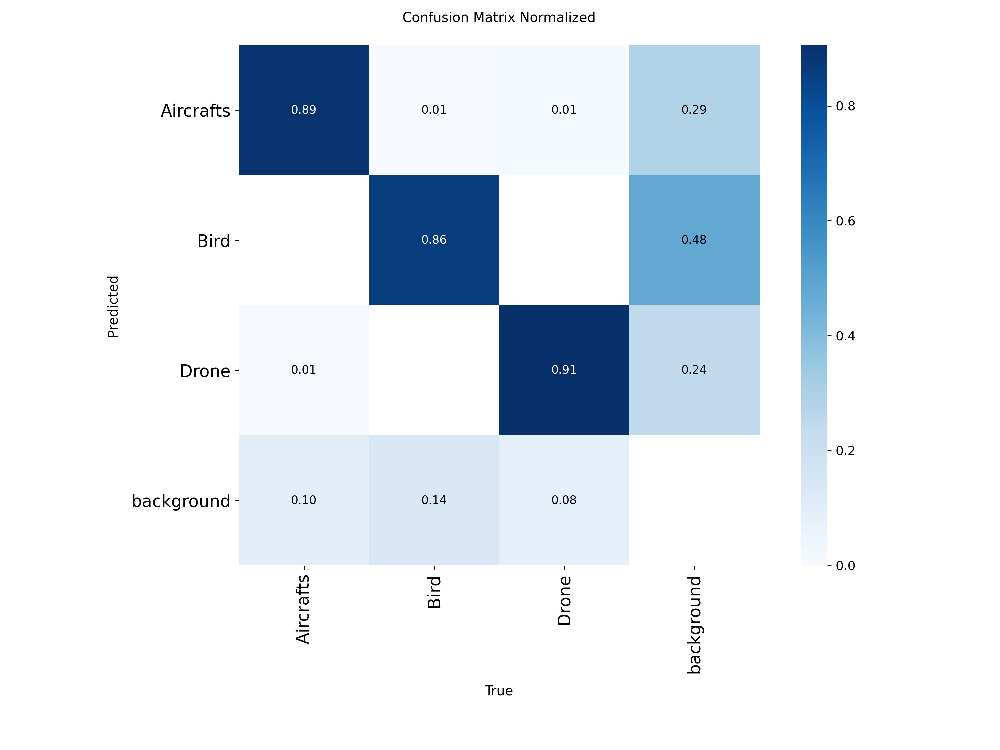
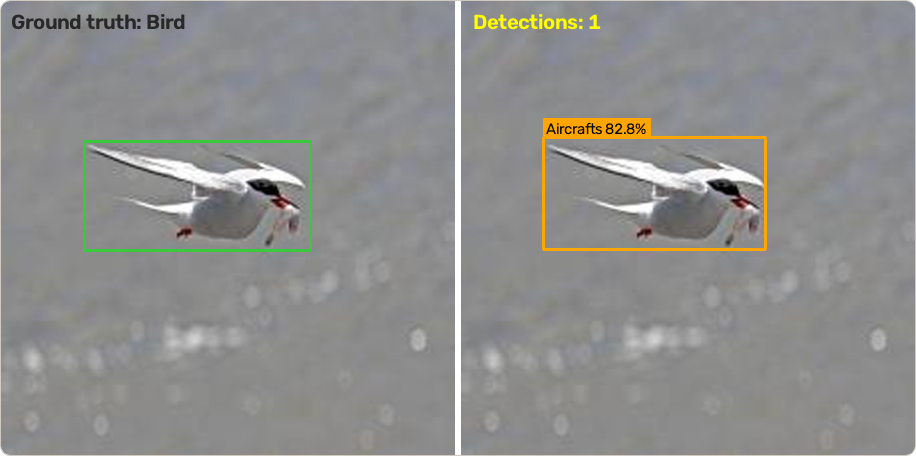

# 11. The aerial detector: the real project

Every example in this guide comes from one real project: a YOLO11 detector for **aircraft, birds and drones** in sky images. This chapter follows it through the steps of the guide, including what went wrong, and shows how to reproduce it. The evidence (logs, plots, console output) is in [`results/`](../results/README.md).

## The goal and the classes (chapter 1)

Tell small drones apart from birds and aircraft in sky images. Three classes: `Aircrafts` (fixed-wing aircraft, jets and helicopters together, because the source labels did not separate them), `Bird` and `Drone`.

## The data (chapters 2 and 3)

A public Roboflow Universe dataset, `subhranil-dey-wttsv/drone-detection-axkso` version 3 (CC BY 4.0), 8,888 images already labelled in YOLO format. Facts recomputed from the files:

| Class | Train instances | Validation instances |
| :-- | :-: | :-: |
| Aircrafts | 4,025 | 977 |
| Bird | 3,826 | 1,159 |
| Drone | 4,073 | 958 |

- 7,110 training and 1,778 validation images; every image has a label file and every label file has at least one box.
- **Every image is 227 x 227 px.** Training at 640 px upsamples them about 2.8 times, and small distant targets are only a few pixels wide.
- The images come from many sources: stock-style photos, product photos, web images and what look like flight-simulator screenshots. Some carry stock-photo watermarks and a few show people. That is why this repository stores only a hand-picked sample (`sample-data/`) and not the whole dataset.

**First problem found:** an early `data.yaml` said `path: ../data`. Running validation from the repository root failed with `images not found`, because Ultralytics resolves a relative `path` from the working directory, not from the YAML (chapter 3). The fix was `path: data`.

## The split (chapter 4)

The original split was random per file. Because the export contains augmented copies of the same source photo, **173 of the 1,778 validation images (9.7%) share a source photo with a training image**. The scores below are therefore probably optimistic. The model was not re-trained on a group-based split.

For a clean split, `python -m yolotools split --group roboflow` on the merged images gives 7,109 training and 1,779 validation images with 0 shared photos (verified; no model trained on it).

## Training (chapter 6)

Two runs of YOLO11s starting from `yolo11s.pt`, batch 16, 640 px, early-stopping patience 5. Logs and arguments are in `results/logs/`.

| Run | Epochs logged | Wall time in log |
| :-- | :-: | :-: |
| Run 1 | 35 | 13,477 s |
| Run 2 (the shipped model) | 57 | 11,576 s |

The GPU model was not recorded.

## Evaluation (chapter 7)

| Evaluation | Precision | Recall | mAP@50 | mAP@50-95 |
| :-- | :-: | :-: | :-: | :-: |
| Fresh validation run on `weights/best.pt`, 2026-11-10 (CPU, Ultralytics 8.4.208) | 0.887 | 0.850 | 0.899 | 0.557 |
| Run 2 training log, last epoch | 0.888 | 0.844 | 0.900 | 0.565 |
| Run 1 training log, last epoch | 0.873 | 0.833 | 0.888 | 0.550 |

Per class: Drone 0.654, Aircrafts 0.588, **Bird 0.428** (mAP@50-95).

What the plots show:

- Training and validation losses flatten around epochs 50 to 57; run 2 stopped there because it reached its configured epoch count.
- Bird and Drone are almost never swapped in the confusion matrix.
- About half of the detections that match no label are Birds (0.48), under a quarter are Drones (0.24) and under a third are Aircrafts (0.29).



## A real mistake (chapter 8)



A tern gliding with its wings spread is labelled `Bird` in the validation labels, and the model calls it `Aircrafts` with 83% confidence. When two classes can look alike, the model needs many varied examples of the one it confuses, and the labels need to be consistent.

## Reproduce it

**1. Get the dataset.** Download version 3 of the Roboflow Universe project above in a YOLO export format (the download needs a free account; this step was not tested) and put all images in one folder and all label files in another, or in one flat folder.

**2. Rebuild the exact split.** The lists in `splits/` name the 7,110 training and 1,778 validation images the results were measured on:

```bash
python -m yolotools apply-split --source all-data --train-list splits/train.txt --val-list splits/val.txt --out data
```

The command prints an error and exits non-zero if any listed file is missing, which tells you whether your download matches. (It was verified on the files used for this project, not on a fresh Roboflow download.)

**3. Check, then train or evaluate.**

```bash
python -m yolotools check --data configs/data.yaml
python scripts/val.py --model weights/best.pt --data configs/data.yaml      # needs the weights, see weights/README.md
python scripts/train.py --data configs/data.yaml --model yolo11s.pt --epochs 60 --batch 16 --device 0
```

On the rebuilt split the validation run reproduced the numbers above exactly, in this repository, on CPU.

## What did not match, and what it teaches

- **The README once quoted last-epoch numbers for a "best" checkpoint.** The best epoch in the log (54, mAP@50-95 0.5674) differs from the last epoch (0.5648), and `best.pt` is most likely the epoch-54 weights. Say which epoch a number is from.
- **A fresh run gave different numbers** (0.557 against 0.565). Different software versions and hardware are the likely cause; it was not investigated. Re-run and record versions (chapter 7).
- **The weakest class was the hardest, not the rarest.** Bird has the most validation instances but the lowest score. More data of the same kind may not fix that; look at the failures first (chapter 8).
- **A documented command was broken** and went unnoticed, because the test checked a different rule from the tool it was meant to protect. Run the real command in a fresh environment.

## What would be done next

1. Re-train on the group-based split to get an honest baseline.
2. Inspect the Bird false alarms and labels.
3. Try a larger image size, then re-check small targets.
4. Keep a separate test set.

None of these has been done; they are suggestions, not results.

Next: [12. The radar view and the hardware trigger](12-radar-view-and-hardware.md)
